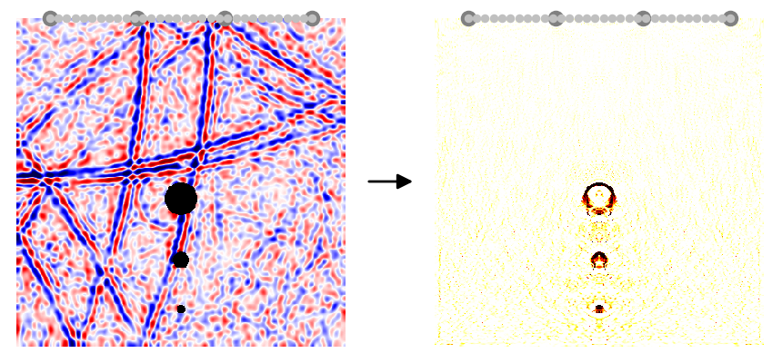
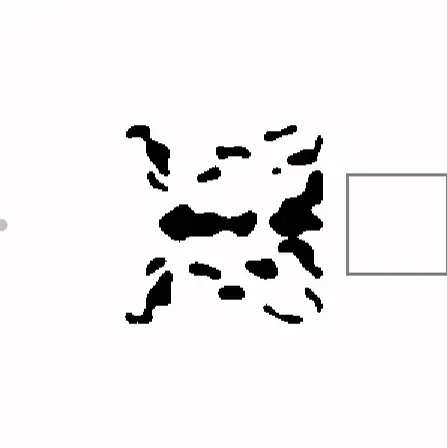

# CuWave

<picture>
  <source media="(prefers-color-scheme: dark)" srcset="https://raw.githubusercontent.com/cmpmech/cuwave/main/.assets/readme-dark.webp">
  
</picture>

**CuWave** is a GPU-accelerated (single or multi), differentiable finite difference wave propagation code.
Possible applications include

<table width="100%">
<tr>
<td valign="middle"><a href="https://www.sciencedirect.com/science/article/pii/S0045782523000166"><strong>nondestructive testing via full waveform inversion</strong></a></td>
<td width="60%" align="right" valign="middle"><picture>
<source media="(prefers-color-scheme: dark)" srcset="https://raw.githubusercontent.com/cmpmech/cuwave/main/.assets/fwi-dark.png">

</picture></td>
</tr>
<tr>
<td valign="middle"><a href="https://doi.org/10.1007/s00158-025-04237-y"><strong>transient acoustic topology optimization</strong></a></td>
<td width="60%" align="center" valign="middle"><picture>
<source media="(prefers-color-scheme: dark)" srcset="https://raw.githubusercontent.com/cmpmech/cuwave/main/.assets/tato-dark.webp">

</picture></td>
</tr>
<tr>
<td valign="middle"><a href="https://www.science.org/doi/10.1126/sciadv.aay6946"><strong>analog neural networks</strong></a></td>
<td width="60%" align="right" valign="middle"></td>
</tr>
<tr>
<td valign="middle"><a href="https://opg.optica.org/josab/fulltext.cfm?uri=josab-38-2-496"><strong>transient photonic topology optimization</strong></a></td>
<td width="60%" align="right" valign="middle"><picture>
<source media="(prefers-color-scheme: dark)" srcset="https://raw.githubusercontent.com/cmpmech/cuwave/main/.assets/tpto-dark.webp">

</picture></td>
</tr>
</table>

## Documentation

- see the [documentation](https://github.com/cmpmech/cuwave/blob/main/docs/Home.md) for how the code works (AI-assisted; verify with sources for critical details)
- see [examples](https://github.com/cmpmech/cuwave/tree/main/examples) for how to apply the code

## Multiple GPUs

Several GPUs take one argument, and the driver otherwise stays as it is:
- `Simulation(..., devices=(0, 1))` splits **one grid** along its first axis over the listed GPUs, for grids too large or too slow for one. `simulate`, `sensitivity`, `reconstruction_sensitivity` and `superposition_sensitivity` then run split and return the same result as on one GPU, bitwise. Try it with the `DEVICES` setting of
	- [examples/forward/scalarND.py](https://github.com/cmpmech/cuwave/blob/main/examples/forward/scalarND.py), the forward problem in 2D or 3D
	- [examples/sensitivity/scalar2D_sensitivity.py](https://github.com/cmpmech/cuwave/blob/main/examples/sensitivity/scalar2D_sensitivity.py), the gradient
- `misfit_gradient(..., devices=[0, 1])` (and `measure`, `misfit`) deals the **shots** of an inversion out over the GPUs, which needs no communication and is the faster choice whenever one shot fits one GPU.
## Development status

**Scalar** & **acoustic wave** equations have been developed over the last 2 years and are thoroughly validated. The **elastic wave** and **electromagnetic wave** equations were developed with AI assistance (Claude). The first is validated on experimental data, while the latter are cross-validated against the independent FDTD code [FDTDX](https://github.com/ymahlau/fdtdx). 
## Performance

CuWave's runtime for identical discretizations is comparable to that of other established wave propagation finite difference codes. Speedups in 2D with reflecting boundaries (**a ratio above 1 means CuWave is that many times faster**) compared to the following frameworks:
- **scalar wave equation**
	- [Deepwave](https://github.com/ar4/deepwave) (forward: ~1.1x, sensitivity: ~1x)
	- [NVIDIA Warp](https://github.com/NVIDIA/warp) (forward: ~2.1x, sensitivity: ~1.8x)
	- [SeismicWaves.jl](https://github.com/GinvLab/SeismicWaves.jl) (forward: ~4.4x, sensitivity: ~4x)
	- [Devito](https://github.com/devitocodes/devito) on CPU (forward: ~3.6x, sensitivity: ~3.8x)
- **elastic wave equation**
	- Deepwave (forward: ~1.1x, sensitivity: ~1.3x)
	- SeismicWaves.jl (forward: ~4x, sensitivity: ~5x)
Tested on one NVIDIA RTX PRO 500 Blackwell laptop GPU (6 GB) on the largest possible grids with CuWave's `superposition_sensitivity` as reference for the sensitivities. The specific numbers need to be taken with a grain of salt, as they are subject to specific hardware and simulation setup. All implementations operate on the same order of magnitude.

Additional benefits of **CuWave** are
- the built-in **higher order finite difference** schemes, allowing for fewer grid points
- a sensitivity analysis whose **memory is independent of the number of timesteps**, allowing for orders of magnitude larger grids

## Install

```bash
pip install cuwave
```

Requires an NVIDIA GPU and [CuPy](https://docs.cupy.dev/en/stable/install.html) matching your CUDA toolkit (e.g. `pip install cupy-cuda12x`), which is not pulled in automatically, or the CPU fallback below. For the full installation, including the optional PyTorch and running the tests, see [docs/install.md](https://github.com/cmpmech/cuwave/blob/main/docs/install.md).

### CPU fallback

CuPy on a GPU stays the default. Without an NVIDIA GPU (or without CuPy) CuWave runs on the CPU instead: NumPy holds the arrays, and the same CUDA kernels are compiled for the CPU at first use and cached in `~/.cache/cuwave`. Results agree with the GPU to floating-point round-off. To force the CPU on a machine with a GPU, set `CUWAVE_DEVICE=cpu` before CuWave is imported, on the command line (`CUWAVE_DEVICE=cpu python examples/forward/scalarND.py`) or at the top of a script, as [examples/forward/scalar2D_cpu.py](https://github.com/cmpmech/cuwave/blob/main/examples/forward/scalar2D_cpu.py) does.

```bash
pip install "cuwave[cpu]"     # adds SciPy, which stands in for cupyx.scipy
```

Requirements:
- a **C++17 compiler with OpenMP** that takes GCC-style flags (GCC or Clang), called as `CXX` (default `c++`) with the flags `CUWAVE_CXXFLAGS` (default `-O3 -march=native -fopenmp -ffp-contract=off`)
- `OMP_NUM_THREADS` sets the number of threads (default: all cores, the right choice on a machine of your own; the step is bound by memory bandwidth, so threads past the physical cores add little)

What that means per platform:
- **Linux**: works with the system GCC, which ships OpenMP (`sudo apt install g++` on Debian/Ubuntu).
- **macOS** (untested): Apple Clang has no OpenMP. Either install it with `brew install libomp` and set
  `export CUWAVE_CXXFLAGS="-O3 -ffp-contract=off -Xclang -fopenmp -I$(brew --prefix libomp)/include -L$(brew --prefix libomp)/lib -lomp"`,
  or use Homebrew's GCC (`brew install gcc`, then `export CXX=g++-15` with the installed version).
- **Windows**: not supported natively, since MSVC does not take GCC-style flags and Python does not find the OpenMP runtime of a MinGW build. Use [WSL2](https://learn.microsoft.com/windows/wsl/install), which is Linux.

The CPU runs the plain kernels only: none of the GPU's blocked and fused fast paths, and no `devices` (several GPUs). It is roughly two orders of magnitude slower than a GPU, so it suits machines without one, tests and small grids.

## References

If you use our code for your scientific research, please acknowledge this by referring to the following publication:

_Herrmann, L., Bürchner, T., Kudela, L., Kollmannsberger, S., 2026, **A memory-efficient adjoint method to enable billion parameter optimization on a single GPU in dynamic problems**, Structural and Multidisciplinary Optimization, Volume 69, 52 (2026), DOI: [10.1007/s00158-025-04237-y](https://doi.org/10.1007/s00158-025-04237-y)_

## Acknowledgements

Ideas adapted from [FDTDX](https://github.com/ymahlau/fdtdx) ([Mahlau, Schubert, Berg & Rosenhahn 2026](https://doi.org/10.21105/joss.08912)), which also serves as the reference for validating the electromagnetic solvers.
## Contact

For questions, bug reports, or collaboration inquiries, please don't hesitate to contact Leon Herrmann at [herrmann.leon@pm.me](mailto:herrmann.leon@pm.me).

## License

MIT; see [LICENSE](https://github.com/cmpmech/cuwave/blob/main/LICENSE).
